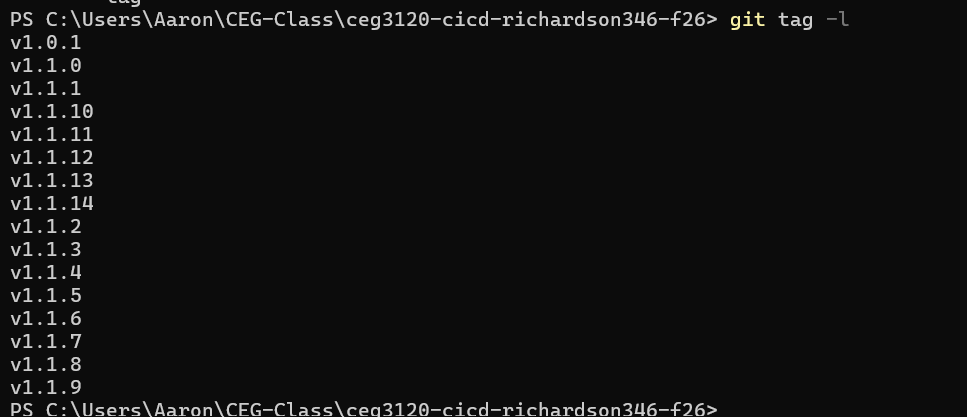
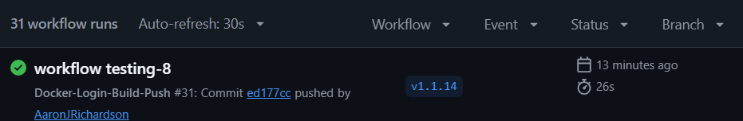
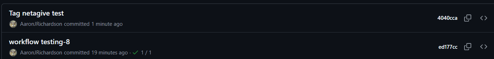

**Part 1 Documentation**
    - The website is a catalog of gaming laptops with an explanation of their specifications. [The main website page](web-content/catalog.html). [The index of available laptops](web-content/index.html). [The style specifications for the website](web-content/style.css)
    - The dockerfile is instructions for the building of the source code of the container. [The dockerfile](web-content/dockerfile)
    - To build an image from my Dockerfile I had used the command ``docker build`` followed by the path to the dockerfile.
    - To run a container for the web service I used the command ``docker run -d -p 8080:80 --name`` followed by the name of the container and the name of the image.

**Part 2 Documentation**
    1. Configuring GitHub Repository Secrets:
        - To create a PAT for my Docker account I needed to go to my profile settings, then go to the personal access token section, then select generate and give it a name. The scope I used was read, write, and delete.
        - To set github secrets one must got the repository, go to its setting, under security go to secrets and variables and select actions. Then click the ``New Repository secret`` button.
        - The secrets for this project include the username of my docker account, and the Personal Access Token.
    2. CI with GitHub Actions
        - The workflow triggers when a remote branch tries to push to the main branch of the repository.
        - The workflow steps start at Checkout, which clones the repository to the runner of the workflow. Next the setup-buildx-action will install the tools needed to build the docker build.  The login-action will take the secrets of the repository and use them to login to the dockerhub account. The next step build-push-action will take the repository and use it to create a container on the specified dockerhub account.
        - If used in a different repository then you would need to change the workflow to reflect the preferred docker hub repository 
        - If used in a different repository then you would need to change the repository to include secrets pointing to a github account with a username and PAT.
        - permalink : https://github.com/WSU-kduncan/ceg3120-cicd-richardson346-f26/blob/bf3a2c3df0ab1682d610fe058254e634fbab231d/.github/workflows/Docker-workflow.yml
    3. Testing & Validating
        - To test my workflow I went to the actions section of the github repository page, and looked if when it ran that it ran successfully with a green checkmark.
        - To verify that my image on dockerhub worked I started the container and searched ``localhost:`` followed by the portnumber I gave to the container/
        - https://hub.docker.com/r/aaronjrichardson/dockerfile

** Part 3 **
1. Generating Tags
    - To see tags in a git repository either us git tags -l on the command line in the repository, or click on tags next to the branches button on the page of the repository.
    - To generate a tag in a git repository use the command ``git tag -a `` followed by the version number of the tag you are creating, that will put that tag on the most recently pushed commit version.
    - To push a tag in a git repository use the command ``git push origin`` followed by the version number of the tag you want to push.
2. Semantic Versioning Container Images with GitHub Actions
    - A workflow trigger is the event that will cause the workflow to run. The trigger for the workflow in step 3 is when the tag of the commit is pushed.
    - The workflow steps start at checkout, which creates a remote copy of the repository. The next step setup-buildx-action will install the tools needed to build the docker build. Next is the docker login which will take the secrets of the repository to login to my docker account. Next is the metadata-action, which will take the name of the image the repository will be built in and combine it with the repository data of the tag version. The last step of build-push-action will take the repository and use it to create a container on the specified dockerhub account and give it the version number tag.
    - If used in a different repository then you would need to change the workflow to reflect the preferred docker hub repository, and the specific tag versioning if it differs from usual tag numbering.
    - If used in a different repository then you would need to change the repository to include secrets pointing to a github account with a username and PAT.
    - [workflow file](.github/workflows/Docker-workflow.yml)
3. Testing & Validating
    - To test my workflow I went to the actions section of the github repository page, and looked if when it ran that it ran successfully with a green checkmark.
    - To verify that my image on dockerhub worked I started the container and searched ``localhost:`` followed by the portnumber I gave to the container/
    - https://hub.docker.com/r/aaronjrichardson/dockerfile

**Part 4 documentation**
1. Continuous Integration Project Overview
    - The goal of this project is to create a guthub repository with proper versioning as it updates a website
    - The tools used in this project include Docker to host the image as it is updated. The actions checkout, setup-buildx-action, login-action, metadata-action, and build-push-action.

**Blockers**
- Despite attempts to complete part 3 of the assignment following the guidance of the metadata actions repository I could not figure out why the website would not update to reflect the changes made. I attempted changing which image the workflow went to, if it was pushing to the right image, and redownloading the image but I could not figure out what was wrong.

2. Resources
    - AI used to generate website html and css from prompt "Generate me 2 html files an a css file for a website themed around gaming laptops"
    - guide on how to implement the metadata-action https://github.com/docker/metadata-action?tab=readme-ov-file#typeref
    - The implementation of the docker/build-push-action https://github.com/docker/build-push-action
    - for proper tagging methods https://semver.org/

**Testing and Proof**
1. Local run: , 
2. Repository secrets: 
3. Main trigger: 
4. Branch negative test: 
5. Change to image: 
6. Tag trigger: . 
7. Tag negative test: 
8. Tag set
9. Two releases
10. Rollback