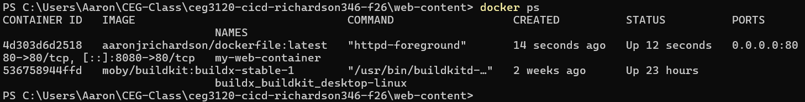
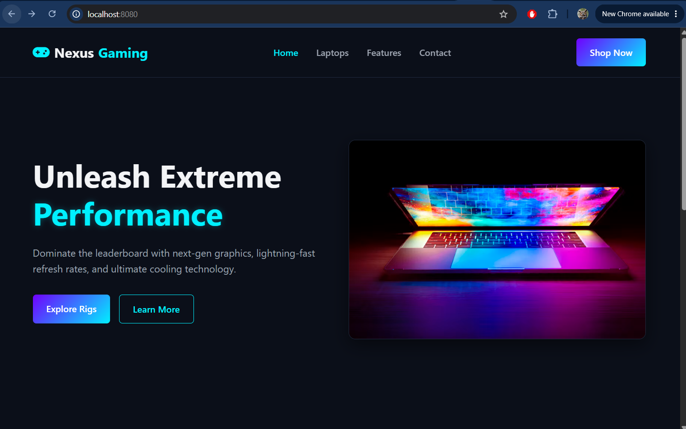
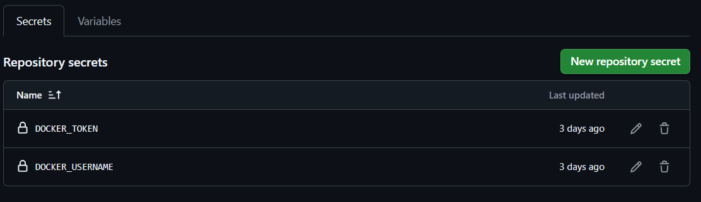
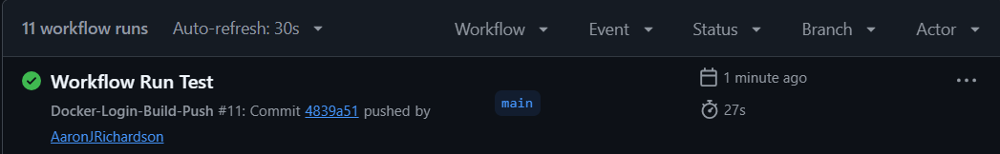
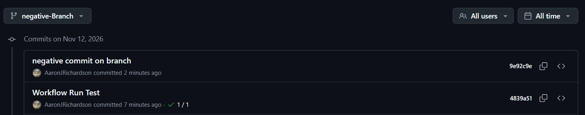
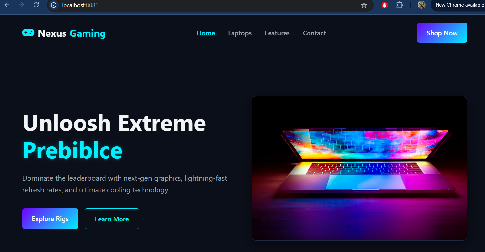

1. Continuous Integration Project Overview
    - The goal of this project is to
    - The tools used in this project include Docker, 

2. Resources
    -

**Part 1 Documentation**
    - The website is a catalog of gaming laptops with an explanation of their specifications. [The main website page](web-content/catalog.html). [The index of available laptops](web-content/index.html). [The style specifications for the website](web-content/style.css)
    - The dockerfile is instructions for the building of the source code of the container. [The dockerfile](web-content/dockerfile)
    - To build an image from my Dockerfile
    - To run a container for the web service

**Part 2 Documentation**
    1. Configuring GitHub Repository Secrets:
        - To create a PAT for my Docker account I needed to go to my profile settings, then go to the personal access token section, then select generate and give it a name. The scope I used was read, write, and delete.
        - To set github secrets one must got the repository, go to its setting, under security go to secrets and variables and select actions. Then click the ``New Repository secret`` button.
        - The secrets for this project include the username of my docker account, and the Personal Access Token.
    2. CI with GitHub Actions
        - The workflow triggers when a remote branch tries to push to the main branch of the repository.
        - The workflow steps start at Checkout, which clones the repository to the runner of the workflow. Next the setup-buildx-action will install the tools needed to build the docker build.  The login-action will take the secrets of the repository and use them to login to the dockerhub account. The next step build-push-action will take the repository and use it to create a container on the specified dockerhub account
        - If used in a different repository then you would need to change the workflow to reflect the preferred docker hub repository 
        - If used in a different repository then you would need to change the repository to include secrets pointing to a github account with a username and PAT.
    3. Testing & Validating
        - To test my workflow I
        -
        -

**Testing and Proof**
1. Local run: , 
2. Repository secrets: 
3. Main trigger: 
4. Branch negative test: 
5. Change to image: 
6. Tag trigger: 
7. Tag negative test
8. Tag set
9. Two releases
10. Rollback